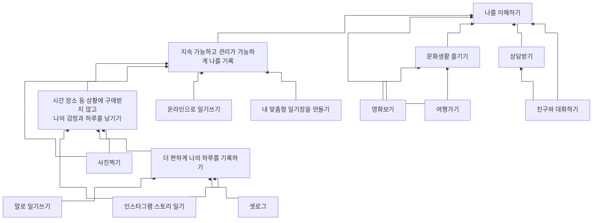

# WHY TREE

우리 팀이 만들려는 앱의 WHY TREE 구조도입니다.
아래에서 위로 "왜 이걸 하는가?"를 따라 올라가면 최상위 목적에 닿고, 위에서 아래로는 "어떻게 달성하는가?"를 나타냅니다.

**최상위 목적: 나를 이해하기**

## 계층 구조

- **나를 이해하기**
  - 지속 가능하고 관리가 가능하게 나를 기록
    - 시간 장소 등 상황에 **구애받지 않고 나의 감정과 하루를** 남기기
      - 더 **편하게** 나의 하루를 기록하기
        - **말로** 일기쓰기
        - 셋로그
      - 인스타그램 스토리 일기 (→ '더 편하게 나의 하루를 기록하기'에도 연결)
      - 사진찍기 (→ '지속 가능하고 관리가 가능하게 나를 기록'에도 연결)
    - 온라인으로 일기쓰기
    - 내 맞춤형 일기장을 만들기
  - 문화생활 즐기기
    - 영화보기
    - 여행가기 (→ '나를 이해하기'에도 연결)
  - 상담받기
    - **친구와 대화하기**

## WHY TREE

## WHY 흐름 예시

- 말로 일기쓰기 → 왜? 더 편하게 나의 하루를 기록하기 위해
- 더 편하게 기록하기 → 왜? 시간·장소 등 상황에 구애받지 않고 나의 감정과 하루를 남기기 위해
- 구애받지 않고 남기기 → 왜? 지속 가능하고 관리가 가능하게 나를 기록하기 위해
- 지속 가능하게 기록하기 → 왜? 나를 이해하기 위해

> 굵게 표시된 항목(말로 일기쓰기, 편하게, 구애받지 않고 나의 감정과 하루를, 친구와 대화하기)은 원본 도식에서 강조된 부분입니다.
