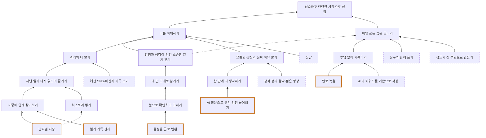

# WhyTree — 말로일기

- 이름: 류대훈
- 날짜: 2026-10-28 (2026-10-29 수정: 중복 단계 정리, How Down 추가)
- 제품: 말로일기 — 하루를 말로 남기고, 잘못 기록된 내용도 말로 고쳐 완성하는 일기 앱
- 대상: 일기를 쓰다 반복해서 멈췄고, 타이핑보다 말하기가 편한 직장인·자영업자

## 읽는 법

- 위로 갈수록 why(목적), 아래로 갈수록 how(방법)입니다.
- [씨앗] 지금 말로일기가 하는 일
- [새 방법] 아직 하지 않지만 How Down으로 새로 찾은 방법
- (점선) 부가적인 why로 이어진 연결. 표시가 없으면 실선(가장 중요한 why)입니다.

## 도식

GitHub에서 상자와 화살표로 보입니다. 주황 굵은 테두리는 [씨앗], 점선 상자는 [새 방법], 점선 화살표는 부가적인 why입니다.

## Tree

- 성숙하고 단단한 사람으로 성장
  - 나를 이해하기
    - 감정과 생각이 담긴 소중한 일기 갖기
      - 내 말 그대로 남기기
        - 눈으로 확인하고 고치기
          - [씨앗] 음성을 글로 변환
    - 과거의 나 알기
      - 지난 일기 다시 읽으며 즐기기
        - 나중에 쉽게 찾아보기
          - [씨앗] 날짜별 저장
          - [씨앗] 일기 기록 관리
        - 히스토리 쌓기
          - (점선) [씨앗] 날짜별 저장
      - [새 방법] 예전 SNS·메신저 기록 보기
    - 몰랐던 감정과 진짜 이유 알기
      - 한 단계 더 생각하기
        - [씨앗] AI 질문으로 생각·감정 끌어내기
      - [새 방법] 생각 정리 음악·짧은 명상
    - [새 방법] 상담
  - 매일 쓰는 습관 들이기
    - (점선) 감정과 생각이 담긴 소중한 일기 갖기
    - 부담 없이 기록하기
      - [씨앗] 말로 녹음
      - [새 방법] AI가 키워드를 기반으로 작성
    - [새 방법] 친구와 함께 쓰기
    - [새 방법] 잠들기 전 루틴으로 만들기

## 메모

- 맨 위 "성숙하고 단단한 사람으로 성장"은 감정에 덜 휘둘림, 더 나은 결정, 같은 실수를 반복하지 않음, 나를 더 좋아하게 됨을 모두 포함함.
- "매일 쓰는 습관 들이기"는 "나를 이해하기"를 거치지 않고 맨 위로 바로 이어짐. 기록 내용보다 매일 쓰는 습관 자체가 성장으로 이어진다고 봄.
- 기록을 고치는 이유: 내가 한 말이 정확하게 남아야 스스로 소중히 여기고 감정과 생각이 묻어남.
- 예전 일기를 찾아보는 이유: 다시 읽는 재미, 그리고 과거의 내가 어땠는지 확인하기.
- AI 질문의 이유: 몰랐던 내 감정과 진짜 이유를 알게 됨.
- "날짜별 저장"의 가장 중요한 why는 "나중에 쉽게 찾아보기"라서 실선, "히스토리 쌓기"는 점선임.
- "감정과 생각이 담긴 소중한 일기 갖기"의 가장 중요한 why는 "나를 이해하기"(실선)이고, "매일 쓰는 습관 들이기"는 점선임. 소중히 여기는 일기일수록 계속 쓰게 되기 때문임.
- 기능 아이디어: "예전 SNS·메신저 기록 보기"에서, 그날의 사진·메시지를 일기 옆에 함께 보여주는 기능을 떠올릴 수 있음.
