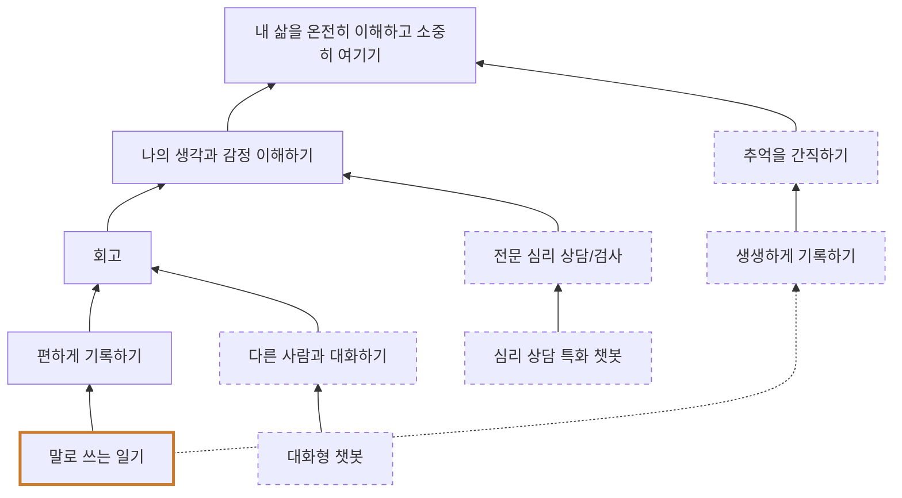

# 일기에서 시작한 WhyTree

- 이름: 우승현
- 날짜: 2026-10-29
- 원본: WhyTree.pptx 2쪽

## 표기

- 들여쓰기: 아래 항목이 how, 위 항목이 그 why (화살표는 아래에서 위로)
- `[씨앗]`: 처음 생각한 일
- `[점선 상자]`: 지금 하지 않지만 새로 찾은 일
- `(실선)`: 가장 중요한 why로 연결
- `(점선)`: 부가적인 why로 연결

## 트리

- 내 삶을 온전히 이해하고 소중히 여기기
  - 나의 생각과 감정 이해하기 (실선)
    - 회고 (실선)
      - 편하게 기록하기 (실선)
        - 말로 쓰는 일기 [씨앗] (실선)
      - 다른 사람과 대화하기 [점선 상자] (실선)
        - 대화형 챗봇 [점선 상자] (실선)
    - 전문 심리 상담/검사 [점선 상자] (실선)
      - 심리 상담 특화 챗봇 [점선 상자] (실선)
  - 추억을 간직하기 [점선 상자] (실선)
    - 생생하게 기록하기 [점선 상자] (실선)
      - 말로 쓰는 일기 [씨앗] (점선)

`말로 쓰는 일기`는 두 why에 연결된 같은 노드입니다. 가장 중요한 why는 `편하게 기록하기`(실선)이고, 부가적인 why는 `생생하게 기록하기`(점선)입니다.

## 도식

